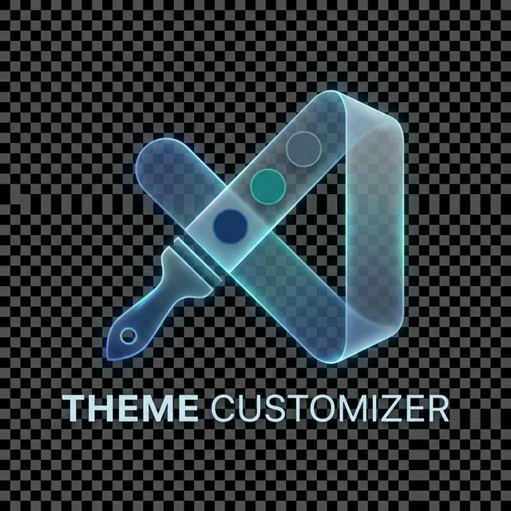

# ThemeCustomizer

A VS Code extension that lets you change editor, UI, and syntax colors from a color picker panel instead of editing `settings.json` by hand.



## Features

- One command, "Open Theme Customizer", opens a webview panel with two tabs: Presets and Custom Colors.
- Six presets: Dark, Light, High Contrast, Monokai Inspired, Solarized Dark, and GitHub Dark. Clicking a preset card applies it.
- Color pickers for editor colors (background, foreground, line numbers, selection, line highlight, cursor), UI surfaces (sidebar, activity bar, status bar, title bar, active tab, panel), and syntax token colors (keywords, strings, comments, numbers, functions, classes, variables, and more).
- Hex fields next to each picker that you can type into directly.
- Export the current colors to a JSON file and import them again later.
- A Reset button that removes `workbench.colorCustomizations` and `editor.tokenColorCustomizations` from your user settings.

## Getting started

The extension is not published to the Marketplace from this repo, so run it from source or package it yourself.

```bash
git clone https://github.com/aprameyak/ThemeCustomizer.git
cd ThemeCustomizer
npm install
npm run compile
```

Then open the folder in VS Code and press F5 ("Run Extension" in `.vscode/launch.json`). In the new window, run "Open Theme Customizer" from the Command Palette.

To build an installable `.vsix` (uses the `@vscode/vsce` dev dependency):

```bash
npx vsce package
code --install-extension custom-code-0.2.0.vsix
```

Other scripts: `npm run watch` (recompile on change), `npm run lint`, and `npm test` (compiles, lints, then runs tests with `@vscode/test-cli`).

## Settings

| Setting | Default | Effect |
| --- | --- | --- |
| `themeCustomizer.autoApply` | `false` | Apply color changes automatically instead of waiting for the Apply button |
| `themeCustomizer.rememberSettings` | `true` | Load your current customizations into the pickers when the panel opens |
| `themeCustomizer.showHexValues` | `true` | Show the hex text field next to each picker |

## How it works

All logic lives in `src/extension.ts`. The command `custom-code.openCustomizer` creates a webview whose HTML, CSS, and script are inlined in that file. The webview posts messages (apply, apply preset, reset, export, import) back to the extension, which writes the results to your user (global) settings under `workbench.colorCustomizations` and `editor.tokenColorCustomizations`. Applying custom colors replaces `workbench.colorCustomizations` as a whole. Syntax colors are written as `textMateRules`; rules for scopes the extension does not manage are kept, and the managed ones are replaced. Presets and imports overwrite both keys. Import expects a JSON file with `workbench` and `tokenColors` keys, the same shape that export produces.

Because the extension writes to global settings, changes apply to every workspace, and any color customizations you made by hand in those keys can be overwritten. Use Reset, or remove the two keys from `settings.json`, to undo the changes.

The repo also has `.github/workflows/create-issues.yml`, a weekly (and manually triggered) workflow that uses the Gemini API to draft starter issues for contributors. It needs a `GEMINI_API_KEY` repository secret.

## Syntax Token Mapping

The `TOKEN_SCOPE_KEYS` object in `src/extension.ts` maps each color picker option to one or more TextMate scopes. For example, `keyword` maps to scopes `keyword`, `storage.type`, and `storage.modifier`; `string` maps to `string`; `comment` maps to `comment`. When you pick a color, the extension writes `textMateRules` entries for all scopes in that group. To add a new token category, add an entry to `TOKEN_SCOPE_KEYS` with the desired scope strings and a corresponding picker in the webview HTML.
## Syntax token mapping

The syntax color pickers are keyed by token category (`keywords`, `strings`, `comments`, and so on). `TOKEN_SCOPE_KEYS` at the top of `src/extension.ts` maps TextMate scopes found in `editor.tokenColorCustomizations` to those categories. It is used when the panel loads colors (on opening, and again after Reset or a preset): each `textMateRules` entry that has a `foreground` is looked up by scope, and the color goes to the matching picker. If two rules name scopes in the same category, the later rule wins.

| Picker category | TextMate scopes |
| --- | --- |
| `keywords` | `keyword`, `storage.type`, `storage.modifier` |
| `controlKeywords` | `keyword.control` |
| `strings` | `string` |
| `templateStrings` | `string.template`, `string.interpolated` |
| `comments` | `comment`, `comment.line`, `comment.block` |
| `numbers` | `constant.numeric`, `constant.language` |
| `constants` | `constant.other` |
| `functions` | `entity.name.function`, `support.function` |
| `classes` | `entity.name.type`, `entity.name.class` |
| `variables` | `variable`, `support.variable` |
| `parameters` | `variable.parameter` |
| `tags` | `entity.name.tag` |
| `attributes` | `entity.other.attribute-name` |
| `punctuation` | `punctuation`, `meta.brace` |
| `operators` | `keyword.operator` |

For example, a rule with scope `storage.type` and a foreground color fills the Keywords picker, and a rule with scope `string.interpolated` fills the Template Strings picker. A scope that is not in the table is ignored when the panel loads. Three pickers fall back to another category when they have no color of their own: Control Keywords uses `keywords`, Template Strings uses `strings`, and Parameters uses `variables`.

When you apply colors, the extension writes `textMateRules` for the same scopes. Existing rules that use any of these scopes are replaced, and rules for other scopes are kept. The `comment.line` and `comment.block` rule is written in italics. To make a new scope editable from the panel, add it to `TOKEN_SCOPE_KEYS` and to the `managedScopes` set and `newRules` list in the apply handler in `src/extension.ts`, and add a picker in the webview HTML. A new category also needs an entry in `resolveThemeColors` and the matching webview wiring.

## Contributing

Issues and pull requests are welcome. Please open an issue to discuss larger changes first, and see `CONTRIBUTING.md` and `CODE_OF_CONDUCT.md`. Run `npm test` before submitting.

## License

MIT, see [LICENSE](LICENSE).
